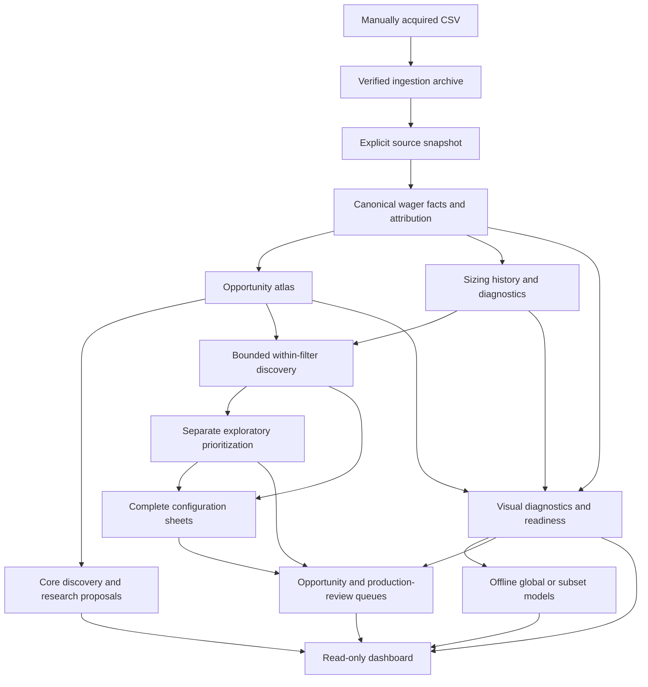
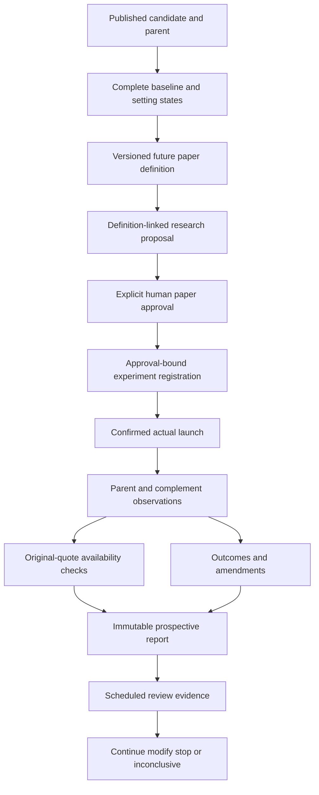
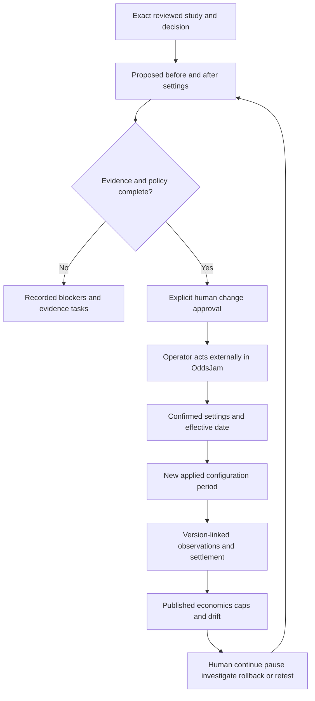

# Current architecture

This is the implemented boundary map. Detailed commands and schemas remain in the
linked component guides. The [implementation ledger](plans/MULTIDIMENSIONAL_IMPLEMENTATION_STATUS.md)
records partial/deferred requirements separately from missing source evidence.

## Historical source to dashboard

Manual ingestion preserves original CSV bytes and source metadata. A snapshot freezes
selected imports/resolutions at its knowledge boundary. Canonical facts establish
wager-grain economics and separate membership/opportunity links. Downstream outputs
retain their own policies and lineage; funding and product populations stay separate.

The [core runner](../src/oddsjam_ev/pipeline/runner.py) coordinates canonical, atlas,
core discovery, recommendations and optional experiment follow-up with frozen plans
and bounded retries. The sizing, within-filter, prioritization, decision, visual,
queue and model extensions use **separate explicit builders**. The diagram shows
logical dependencies, not one command that runs all branches. See
[analyst instructions](guides/ANALYST.md) and [core pipeline](WEEKLY_RESEARCH.md).

[The Streamlit app](../dashboard/app.py) attaches the exact configured publications,
verifies bytes and lineage and renders supported scopes. It does not acquire sources,
rerun tests, construct new inference families, train models or write live registers.
[Visual readiness](VISUAL_DIAGNOSTICS.md) distinguishes supported/partial/blocked
series. Model filtering selects frozen predictions; an offline subset refit retains
a separate identity. See [explanations](DASHBOARD_EXPLANATIONS.md).

## Candidate to prospective review

A candidate is a historical hypothesis. The configuration sheet combines supported
baseline evidence with proposed restrictions, retaining unknown/unset/inherited states.
A future [definition](PROSPECTIVE_PAPER_DEFINITIONS.md) freezes rules and review intent;
registration, approval and actual launch are distinct events. Capture includes the
parent and complement, decision-time feature/quote evidence and unavailable quotes.
Reports retain outcomes by exact version, including unsettled or late facts.

[Prospective integration](PROSPECTIVE_EXPERIMENT_INTEGRATION.md) binds these records.
A scheduled date alone is not a completed review. The
[reviewed lifecycle](REVIEWED_FILTER_LIFECYCLE.md) records the human decision and any
future follow-up version. No historical export or dashboard selector implicitly
creates enrollment, launch, approval or a new definition.

## Proposed change to applied monitoring

Proposals retain the previous configuration and full setting diff. TEST changes and
production pilot requests have different gates. A production assessment can permit
bounded human review only under the approved prospective policy; a legacy PROD
baseline is explicitly not a newly qualified promotion.

Approval does not establish that OddsJam settings were changed. An operator acts
externally and separately records the actual settings/effective date. Monitoring
keeps application periods, reported real-money economics and hypothetical paper
observations distinct. Rollback creates another recorded change/period; late
settlements stay with their original version. The tool records and monitors caps
but cannot enforce them inside OddsJam. See [lifecycle contracts](REVIEWED_FILTER_LIFECYCLE.md).

## Storage and compatibility

- **Immutable publications:** verified manifest plus output files; altered inputs,
  policy or implementation yield new identities. Old outputs remain intact.
- **Registers:** explicit append-only event histories; publication builders freeze
  their reviewed state. The dashboard reads these snapshots, not the live journals.
- **Attempt/checkpoint records:** core orchestration receipts and reuse/failure state;
  a successful attempt is not a statistical pass or a new observation period.
- **Legacy notebook path:** preprocessing and notebook assumptions remain independent
  of canonical publications. Notebook results are not silently imported into a new run.

Raw data and processed outputs remain in ignored local storage. This structure does
not provide automatic backups, hosted capacity guarantees or external deployment.
For definitions and distinctions, use the [glossary](GLOSSARY.md).

[Documentation home](README.md)
