# Release acceptance and first study workflow

This is the final planned gate in the dashboard decision-workspace sequence. Passing
it means the supported research workflow is usable; it does not mean a profitable
candidate exists, an unknown scanner control is safe to leave at its default, or a
paper study is approved. Missing source evidence remains visible.

## What is verified

```mermaid
flowchart LR
    S[Explicit historical snapshot] --> D[Discovery and corrected comparisons]
    D --> C[Complete configuration sheet]
    C --> V[Frozen prospective definition]
    V --> A[Human paper approval]
    A --> L[Confirmed actual launch]
    L --> O[Parent observations and complement]
    O --> Q[Original quote availability and settlement]
    Q --> R[Scheduled human review]
    R --> M[Versioned modification proposal]
    M --> H[Approval then confirmed application]
    H --> N[Version-specific monitoring]
    N --> R
```



Historical association, prospective evidence, review approval and actual application
are separate records. A name containing `PROD` does not establish deployed status.
A model explanation describes a fitted prediction, not the causal effect of changing
a scanner setting. The dashboard reads immutable publications; ordinary interactions
never train, launch, enroll, approve or deploy anything.

| Acceptance surface | Reproducible evidence | Required behavior |
| --- | --- | --- |
| Discovery through monitoring | `tests/test_release_acceptance.py`, `tests/test_production_lifecycle.py` | Exact candidate/configuration references, future versions, explicit launch/review/application, no cross-version pooling |
| Positive / negative / ambiguous / no winner | Release scenario tests and `tests/test_promotion.py` | Full eight-claim family per definition; missing/unfavorable evidence cannot become a winner |
| Economics and denominators | `scripts/verify_release.py`, visual tests | Unique wager IDs, identical source stake/profit, population counts, weighted and equal-stake reconciliation; overlaps never added |
| Requested notebook charts | Ten-chart inventory and per-scope readiness | Supported source data or explicit remediation, including optional closing series |
| Model integrity | Verified global/subset loaders and explanation tests | Event-disjoint splits, training-only background, SHAP additivity, observed target reconciliation, exact lineage, no implicit refit |
| Immutable replay and corruption | Release/publication/cache tests | Stable bytes on replay; changed bytes rejected even after a cached view |
| Dashboard behavior | AppTest plus real Chrome walkthrough | Shared selection/reset, exact deep links, setup sheets, charts, download-only draft actions, explicit empty states |
| Performance | Loader timings/RSS and browser initial-render time | Report environment, population size and measurement scope; no latency or memory claim from unit tests alone |

## Run the acceptance checks

Install the locked application and dashboard dependencies first:

```bash
poetry install --with dashboard
poetry check --lock
poetry run ruff check .
poetry run ruff format --check .
poetry run pytest -q
git diff --check
```

For a publication smoke check, choose an **explicit run ID** from the intended local
configuration. This command does not select a newer snapshot, acquire data, write
journals, rebuild artifacts or train models:

```bash
poetry run python scripts/verify_release.py \
  --config configs/dashboard.yaml \
  --run-id <exact-published-run-id> \
  --repeats 3 \
  --max-cold-seconds 10 --max-warm-seconds 5 --max-rss-mib 3072 \
  > /private/tmp/oddsjam-release.json
```

The JSON report lists verified versus unattached components, economics reconciliation,
all chart readiness/remediations, global/subset model availability, cold load time,
individual warm rechecks and process peak resident memory. Loader timings exclude
Python startup/imports and browser rendering. RSS includes imports and reflects the
process high-water mark. Warm checks still hash bytes; they do not trust mtimes.
The three optional performance budgets must be supplied together; a violation exits
with status 2. They are engineering limits for the selected workload, not research
thresholds. A corrupt artifact raises an error and exits nonzero instead of producing a pass.
An unattached optional component is **not** a successful test of that component.

Do not commit these local reports or screenshots without a privacy review. Synthetic
fixtures run without private history or network access. To retain an isolated fixture
for manual inspection, use a fresh dedicated temporary base directory:

```bash
poetry run pytest tests/test_release_acceptance.py \
  -k release_publications --basetemp=/private/tmp/oddsjam-release-fixture
```

That test writes a `dashboard.yaml` inside its own fixture directory. Never point
`--basetemp` at a directory containing data you need to retain; pytest owns that tree.

## Real-browser walkthrough

AppTest checks widget state and backend behavior; it does not prove that rendered
charts fit, hover works, or the layout is legible. Use an isolated local Chrome
profile and a private screenshot directory. Node 22+ provides built-in WebSocket;
no additional npm packages are needed. The harness accepts loopback URLs only.

```bash
poetry run streamlit run dashboard/app.py \
  --server.address 127.0.0.1 --server.port 8519 \
  --server.headless true --browser.gatherUsageStats false

# In another terminal; adjust the Chrome executable for your OS.
"/Applications/Google Chrome.app/Contents/MacOS/Google Chrome" \
  --headless=new --remote-debugging-address=127.0.0.1 \
  --remote-debugging-port=9231 \
  --user-data-dir=/private/tmp/oddsjam-release-chrome \
  --no-first-run --no-default-browser-check about:blank

# In a third terminal:
ACCEPTANCE_OUTPUT=/private/tmp/oddsjam-release-browser \
  node scripts/acceptance/browser.mjs
```

Set `ODDSJAM_DASHBOARD_CONFIG` on the Streamlit process to use the synthetic config.
`ACCEPTANCE_URL` and `ACCEPTANCE_CDP` override the loopback defaults. Inspect the
saved screenshots at 1440×900 and 1366×768; automated overflow/error assertions alone
do not establish visual quality. Review readable labels, unclipped metrics, clear
empty states and whether the next research action is understandable. See the dated
[release evidence](releases/2026-11-02-acceptance.md) for results and remaining limits.

## Identify three or four studies after release

1. Start on **Overview**, all funding/products and no signal restrictions. Read the
   evidence-tier counts and current source snapshot before selecting ideas. The
   queue can legitimately contain fewer than four supported hypotheses.
2. Use **Opportunities** to inspect distinct ideas. Prefer corrected comparisons when
   present; inspect subgroup, parent and complement, both return measures, event
   support, concentration, missingness and overlap. Broad support is not proof of
   profitability. Several overlapping slices are not independent studies.
3. Open **Full OddsJam setup** for each selected idea. Review every control, its
   explicit/inherited/unset/unknown state, baseline version and translation evidence.
   Resolve unknown controls before configuring a faithful test. A two-field predicate
   is a subgroup restriction, not permission to reset every other scanner setting.
4. Download the study draft, complete the future dates, fixed paper sizing, baseline,
   availability protocol, family and scheduled review. Follow
   [paper definitions](PROSPECTIVE_PAPER_DEFINITIONS.md) and
   [prospective integration](PROSPECTIVE_EXPERIMENT_INTEGRATION.md) to register, review,
   approve and confirm the actual launch. Downloading is not approval or launch.
5. Capture the parent and complement prospectively, timely original quotes and
   unavailable opportunities, then settlements. Publish outcomes explicitly and
   attach the exact definitions/outcome publications to the dashboard configuration.
6. At the planned review, record continue/modify/stop/inconclusive. A modification
   creates a future version. Use [reviewed lifecycle](REVIEWED_FILTER_LIFECYCLE.md)
   for proposed/approved/applied settings, monitoring and rollback. An approved bounded
   pilot requires its own qualifying prospective evidence and explicit human decision.

For existing filters, **Production health** applies only to confirmed effective-dated
PROD status. Inspect proposed exclusion versus retained complement and the complete
before/after sheet. A historical loss or counterfactual removal is not evidence that
the change would improve future profitability.

## What follows this release

There is no additional feature PR required by this sequence before reviewing ideas
and preparing paper studies. Actual launch may still be blocked by missing baseline,
scanner translation or source evidence. New evidence can be recorded through existing
contracts; a contract change or genuine defect needs a focused PR.

A separate [documentation overhaul plan](plans/DOCUMENTATION_OVERHAUL.md) consolidates
the growing documentation without delaying research. Acquisition/scheduling, new
statistical policies, additional scanner features and automatic trading are outside
this release. Release acceptance is not a substitute for prospective observation.
