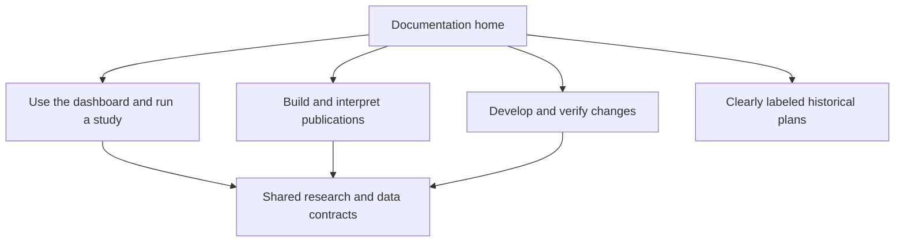

# Documentation consolidation after release acceptance

This four-PR documentation sequence does not gate candidate review. J delivers
navigation and the implementation audit; K supplies executable walkthroughs and
synthetic screenshots. L consolidates the shared contract reference; M remains
follow-up work. Preserve
research contracts and the distinction between implemented behavior, historical
notes and proposals. Do not rewrite historical evidence to match current defaults.

| PR | Deliverable | Suggested Conventional Commits |
| --- | --- | --- |
| **J — Navigation, architecture and status** | Delivered: [documentation home](../README.md), role guides, [architecture](../ARCHITECTURE.md), [glossary](../GLOSSARY.md) and [requirement ledger](MULTIDIMENSIONAL_IMPLEMENTATION_STATUS.md) with partial/evidence-blocked/deferred work explicit | `docs: organize operator analyst and contributor guides` · `docs: reconcile discovery plans with implemented capabilities` |
| **K — Operator walkthroughs** | Delivered: [staged synthetic tutorial](../walkthroughs/README.md), tested real CLI commands, [configuration/publication map](../CONFIGURATION_PUBLICATION_MAP.md), [troubleshooting/remediation](../TROUBLESHOOTING.md) and watermarked synthetic screenshots | `docs: add reproducible dashboard and paper-study walkthroughs` |
| **L — Research and data reference** | Delivered: [authoritative shared references](../reference/README.md), implementation/test links and separately documented approved exploratory/promotion policies; component guides link to shared explanations | `docs: consolidate research and data contracts` |
| **M — Maintenance and presentation** | Normalize headings/tables/code fences, relative links and diagram accessibility; archive superseded plans with migration links; CI checks for local links and documented CLI examples | `chore: validate documentation links and examples` |

Acceptance: a new user can locate the exact build and launch commands, distinguish
paper approval from actual launch and PROD deployment, explain an unknown control,
and trace a displayed metric to a versioned source without reading all planning
history. Every Mermaid diagram has nearby prose explaining the same workflow.
Examples must use synthetic data and preserve mandatory human decisions. Prefer
one authoritative explanation with links over copied contracts that drift apart.

Keep the overhaul separate from methodological changes or a redesign. Do not add
generic Markdown beautification dependencies unless they solve an identified
maintenance problem. Preserve contributor edits and private roadmap notes.

## Parallel evidence work and conditional extensions

The [implementation ledger](MULTIDIMENSIONAL_IMPLEMENTATION_STATUS.md#remaining-work-and-its-next-action)
records reasons, prerequisites and next actions. Confirm scanner baselines/lifecycle,
source timing/liquidity/closing semantics and prospective observations through the
existing contracts. These are operational/evidence tasks unless a source adapter or
contract is actually missing.

Optional development includes pinned orchestration of newer builders, integrated
chronological evaluation of the within-filter family, the remaining chart forms and
drill-through, threshold/calibration studies, outside-universe widening, supported
bankroll scenarios and environment-specific hosting benchmarks. These are separately
scoped changes with prerequisites, not part of the documentation PRs or promises that
all original proposals are already implemented. Candidate review can proceed while
unknown setup evidence continues to block an individual launch.
