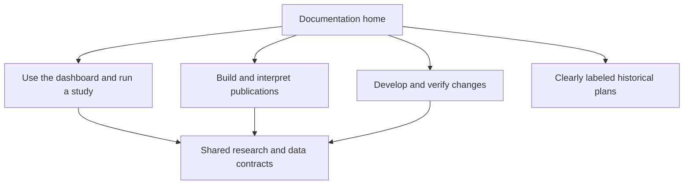

# Documentation consolidation after release acceptance

The next documentation project is useful but does not gate candidate review. Preserve
research contracts and the distinction between implemented behavior, historical
notes and proposals. Do not rewrite historical evidence to match current defaults.

| PR | Deliverable | Suggested Conventional Commits |
| --- | --- | --- |
| Documentation navigation and architecture | Task-based docs home; current architecture Mermaid diagrams; publication/register glossary; clear entry points for operator, analyst and contributor | `docs: organize operator analyst and contributor guides` |
| Operator walkthroughs | Synthetic copyable discovery-to-paper and modification examples; configuration/publication map; troubleshooting and evidence-remediation guide; current screenshots using synthetic data | `docs: add reproducible dashboard and paper-study walkthroughs` |
| Research and data reference | Consolidated grains, units, eligibility, chronology, missingness, corrections, SHAP interpretation, effective-date and source-lineage references; link to implementation and tests | `docs: consolidate research and data contracts` |
| Maintenance and presentation | Normalize headings/tables/code fences, relative links and diagram accessibility; archive superseded plans with migration links; CI checks for local links and documented CLI examples | `chore: validate documentation links and examples` |

Acceptance: a new user can locate the exact build and launch commands, distinguish
paper approval from actual launch and PROD deployment, explain an unknown control,
and trace a displayed metric to a versioned source without reading all planning
history. Every Mermaid diagram has nearby prose explaining the same workflow.
Examples must use synthetic data and preserve mandatory human decisions. Prefer
one authoritative explanation with links over copied contracts that drift apart.

Keep the overhaul separate from methodological changes or a redesign. Do not add
generic Markdown beautification dependencies unless they solve an identified
maintenance problem. Preserve contributor edits and private roadmap notes.
