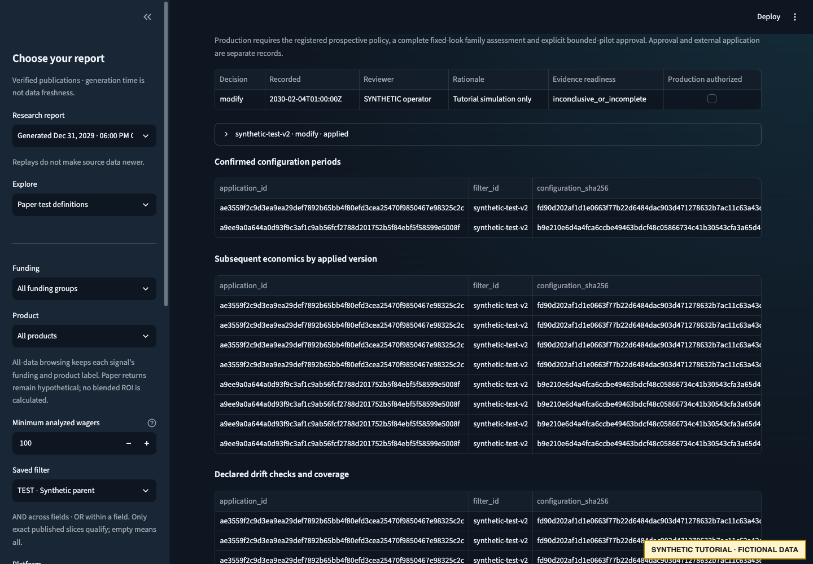

# Review and modify a filter

Continue after the [synthetic paper study](PAPER_STUDY.md). The first study remains
inconclusive. A human can propose a new future paper TEST while retaining that fact;
it is not an automatic exclusion, an inferred benefit or a production promotion.

## 1. Propose a reviewed future TEST change

```bash
poetry run python docs/examples/operator_demo.py --workspace "$WALKTHROUGH_ROOT" \
  propose-change --acknowledge-synthetic-decision
```

The adapter:

- Creates definition version 2 for February 5–March 5, with March 7 review, linked to
  version 1. Rules/settings remain pinned; old intent and observations are not pooled.
- Records a **modify** decision against the exact first-study report and completed
  review event. The source blockers remain; `production_authorized` remains false.
- Imports a fictional preexisting **TEST** application with market width 25 as
  explicit baseline evidence, distinct from the study's configuration history.
- Proposes modifying that TEST to the complete future baseline with market width
  explicitly unset. This is a teaching change, **not a recommendation to loosen
  market width** or a claim that results support doing so.
- Retains the previous application/settings in `rollback-evidence.json` and the
  append-only lifecycle journal.

The change has a meaningful before/after diff, a future definition and explicit
synthetic UI translation evidence. The future definition is **not approved, registered
or launched** by this step. Proposed scanner application is separate from future capture.

## 2. Approve the exact request

```bash
poetry run python docs/examples/operator_demo.py --workspace "$WALKTHROUGH_ROOT" \
  approve-change --acknowledge-synthetic-decision
```

This records **APPROVE_CHANGE** with the exact request ID and current journal head.
The prior application remains current. Approval does not prove anything changed
externally, and the helper does not connect to OddsJam.

## 3. Confirm external application separately

```bash
poetry run python docs/examples/operator_demo.py --workspace "$WALKTHROUGH_ROOT" \
  confirm-application --acknowledge-synthetic-decision
```

The fictional operator now confirms the actual settings and effective date. A second
application period is created; the previous TEST period closes without erasing its
history. Observation linkage uses the **normalized applied settings hash**, not an
unverified draft hash. In reality this event requires evidence of what the operator
actually applied externally.

## 4. Monitor and record human follow-up

```bash
poetry run python docs/examples/operator_demo.py --workspace "$WALKTHROUGH_ROOT" \
  monitor --acknowledge-synthetic-decision
```

The example records one paper observation under the new application and its outcome,
publishes monitoring, records an explicit **investigate** review and publishes a new
immutable report. Earlier monitoring reports remain unchanged. There is no automatic
pause/rollback or promotion. Monitoring still requires 100 wagers/events for its
support interpretation; one winning observation does not pass that gate.

Restart Streamlit using `dashboard-monitored.yaml` and open **Paper-test definitions**
to inspect the reviewed change and confirmed application evidence for the source study.

```bash
ODDSJAM_DASHBOARD_CONFIG="$WALKTHROUGH_ROOT/dashboard-monitored.yaml" \
  poetry run streamlit run dashboard/app.py
```



All displayed changes are fictional TEST records; no funded pilot or real settings
were created. The report retains application boundaries and links to the decision.

## Rollback and other decisions

The tutorial retains the old baseline application ID, full settings, decision/change
IDs and immutable report references. It **does not execute a rollback**. A real
rollback needs its own reviewed change, current application reference, target
application/settings evidence, approval and confirmed effective date. Follow the
[reviewed lifecycle reference](../REVIEWED_FILTER_LIFECYCLE.md).

The same reference documents **continue**, **stop** and **inconclusive** decisions.
Continue/modify requires a new future definition. Stop is a human decision; actual
external retirement remains separate. Inconclusive preserves missing/conflicting
information without granting a pass. Do not change the first study's outcome merely
to demonstrate every action in one journal.

Next: [refresh research from another synthetic export](REFRESH_RESEARCH.md).
