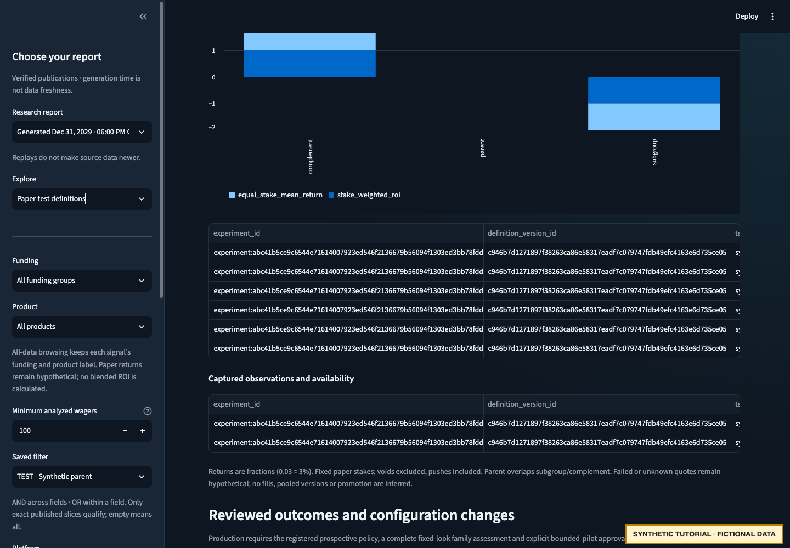

# Define and launch a paper study

Continue in the same [synthetic workspace](README.md). These are separate explicit
steps; review the generated files between commands. All decisions are fictional.

## 1. Save a definition, without approval or launch

```bash
poetry run python docs/examples/operator_demo.py --workspace "$WALKTHROUGH_ROOT" define
```

Inspect `definition.json`, `definition-next.json` and the newest entry in
`definitions-register/`. The adapter selects the exact within-parent Demo A predicate,
pins the complete baseline and configuration record hash, and declares:

| Field | Synthetic choice |
| --- | --- |
| Parent / subgroup / complement | Both books / Demo A / Demo B |
| Planned capture | January 2–February 2, 2030 |
| Scheduled review | February 4, 2030, after two-day settlement follow-up |
| Sizing | Fixed $1 paper stake, both arms, no funded stake |
| Availability | Record original quote/selection/line, check timestamp and available capacity, including failures |
| Review | Continue only with a new future version; stop on mismatch; inconclusive when support/availability is insufficient |
| Configuration | Exact published sheet identity and record hash; no automatic defaults |

The definition has status `definition_only_not_launched`. Its proposal is a request
for human review, not approval. No experiment register exists yet.

## 2. Explicitly approve and register

```bash
poetry run python docs/examples/operator_demo.py --workspace "$WALKTHROUGH_ROOT" \
  approve-study --acknowledge-synthetic-decision
```

The tutorial records **UNDER_REVIEW**, then **APPROVED**, then approval-bound
experiment registration, each using exact IDs and expected state/head. A descriptive
lifecycle review policy is recorded separately. Inspect `approvals/`, `experiments/`
and `commands.jsonl`: the experiment is registered, **not RUNNING**.

In real operations, a human reviews the exact protocol and evidence before these
commands; a tutorial acknowledgement is not authorization for your real candidates.

## 3. Confirm actual launch separately

```bash
poetry run python docs/examples/operator_demo.py --workspace "$WALKTHROUGH_ROOT" \
  launch --acknowledge-synthetic-decision
```

The adapter records a RUNNING transition with a confirmed synthetic launch time,
scanner identity and exact parent configuration. No OddsJam API or scanner is used.
For a real study, record this only after the reviewed setup and actual capture start
are supported. A planned start date passing is not launch evidence.

## 4. Capture both arms and record a scheduled review

```bash
poetry run python docs/examples/operator_demo.py --workspace "$WALKTHROUGH_ROOT" \
  capture-review --acknowledge-synthetic-decision
```

This advances the synthetic calendar and executes these real event interfaces:

1. **ENROLL:** one Demo A observation and one Demo B complement observation, each
   with distinct event ID, decision-time feature provenance, original quote and
   baseline configuration hash.
2. **CHECK:** original offer available at $1 for Demo A; unavailable for Demo B.
   The failed check is retained. Neither is recorded as an accepted real fill.
3. **SETTLE:** Demo A loses; Demo B wins. The unavailable complement's return remains
   hypothetical and separate from original-quote-checked results.
4. **TRANSITION:** confirm capture ended and move to awaiting outcomes.
5. **Publish → REVIEW → publish:** pin the report actually reviewed, record explicit
   scheduled review evidence, then publish the updated review state.
6. **READY_FOR_REVIEW → publish:** readiness permits human review, not a statistical pass.

The study has only two observations and insufficient original-quote capacity in the
complement. The 100-wager/event gates are unchanged; **the example is inconclusive**.
Synthetic historical success cannot rescue its prospective evidence.

## 5. Attach outcomes explicitly

Stop/restart Streamlit with:

```bash
ODDSJAM_DASHBOARD_CONFIG="$WALKTHROUGH_ROOT/dashboard-reviewed.yaml" \
  poetry run streamlit run dashboard/app.py
```

Open **Paper-test definitions**, expand the study, and inspect per-version outcomes,
availability and review readiness. This configuration pins the original definition
publication and the new outcome report. It does not read the live journal.



The screenshot contains only fictional evidence. Two observations demonstrate the
workflow; they do not meet the support policy or permit a production pilot.

## Production CLI equivalents

`commands.jsonl` retains the actual arguments used by:

- `manage_paper_definitions.py draft/save/publish`
- `build_definition_proposal.py`
- `record_research_decision.py record`
- `manage_experiments.py register/event`
- `build_experiment_report.py`

For production syntax and required fields, use the
[prospective integration reference](../PROSPECTIVE_EXPERIMENT_INTEGRATION.md).
Never copy synthetic dates, configuration evidence or approval rationale into real
registers. [The map](../CONFIGURATION_PUBLICATION_MAP.md) distinguishes each input/output.

Next: [review and modify the synthetic TEST filter](MODIFY_FILTER.md).
