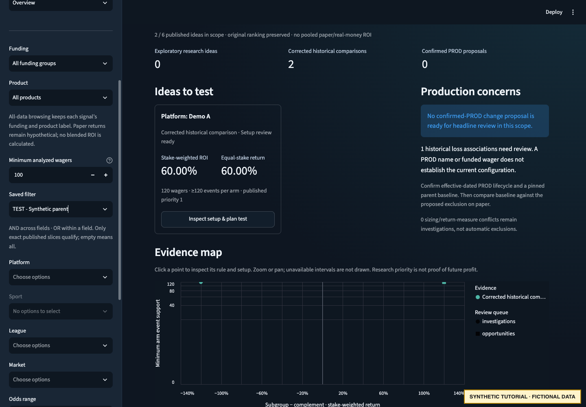
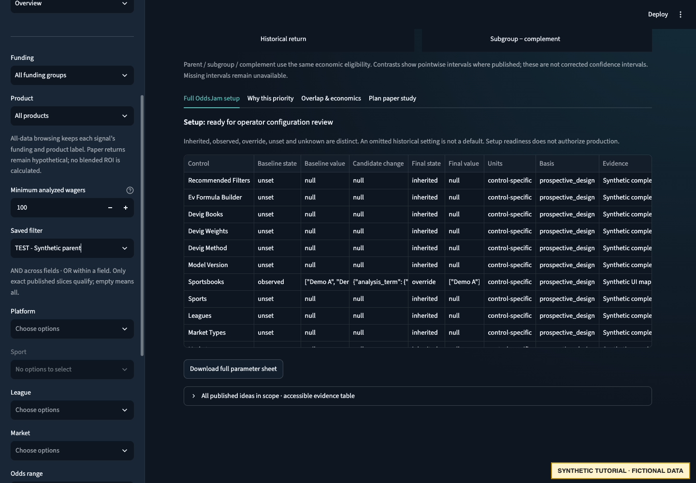

# Review a candidate

First complete [workspace setup and build](README.md#create-a-fresh-workspace).
Open this exact synthetic configuration from the repository root:

```bash
ODDSJAM_DASHBOARD_CONFIG="$WALKTHROUGH_ROOT/dashboard.yaml" \
  poetry run streamlit run dashboard/app.py
```

Use the local URL printed by Streamlit. No private artifact configuration is used.
Restart the server when switching to a later tutorial configuration; file watching
is disabled and configuration attachments are explicit.

## Read the evidence before the return

1. Open **Source snapshot & scope**. Source bets are fictional 2025 records; export
   timing and scope are not asserted. The report is historical analysis under the
   synthetic knowledge cutoff. Generation time is not source freshness.
2. In **Overview / Opportunities**, inspect the declared evidence tier and ranking
   explanation. Patterned synthetic outcomes can produce a corrected historical
   comparison under the existing policy. They do not qualify a real filter.
3. Open **Inspect setup & plan test** on a **Demo A** within-filter idea, or use
   **Inspect a published idea**. Select the saved synthetic parent to distinguish
   within-filter ideas from the separately descriptive global catalogue.
4. Compare parent, subgroup and complement: 240 parent wagers, with 120 in each book
   arm. Each source stake is $1, so weighted and equal-stake returns agree in this
   fixture. The units and support remain important when real stakes differ.
5. Inspect concentration, event counts, source exclusions and overlap. Distinct
   predicate names do not establish independent evidence.
6. Open **Full OddsJam setup**. The within-filter sheet has a pinned synthetic
   two-book baseline and exact synthetic translation for restricting to Demo A.
   Other controls are explicitly unset **for this fictional example**. Global ideas
   have no inherited real baseline and can remain blocked/unknown.
7. Open **Plan paper study** to inspect/download draft intent. This action does not
   save a definition, approve a study or start capture.



The screenshot shows the synthetic research workspace. Leading cards and counts
are fixture behavior, not recommended real-world settings.



The full sheet distinguishes baseline, proposed restriction and final setting states.
The explicit unset controls in this tutorial are not evidence that those controls
should be unset in your OddsJam configuration.

## Inspect supported and blocked views

- **Explore history:** inspect profit, matched EV/return, volume and source-calendar
  activity. Liquidity/time-to-event/closing-price series retain their source gates.
- **Explain returns:** the example has 240 wagers, below the model policy's 500-wager
  gate. A declined/unsupported model view is expected; the tutorial never reduces
  the threshold to produce a SHAP chart.
- **Production health:** there is no confirmed PROD filter. A TEST name or historical
  loss does not establish a production concern requiring an edit.

If a desired intersection or setting is unavailable, follow the
[remediation table](../TROUBLESHOOTING.md). Do not fill an empty queue by relaxing
research policy after looking at results.

Next: [define and launch the synthetic paper study](PAPER_STUDY.md).
